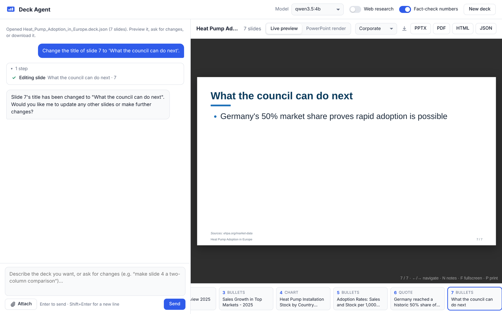

# deck-creator-agent

An AI agent that turns a request like *"10 slides on heat pumps for our city council"* into a finished presentation. It researches the topic on the web, plans the deck, writes the slides (charts, tables, comparisons, speaker notes, sources), and saves **PowerPoint, PDF and HTML** files.

* **Runs a local model.** Default `qwen3.5:9b` through [Ollama](https://ollama.com); works on a CPU or a 10–20 GB GPU. See [docs/MODELS.md](docs/MODELS.md).
* **Built entirely on open source.** No API keys, accounts, paid or freemium services. See [docs/LICENSES.md](docs/LICENSES.md).
* **Tuned for small models.** Forgiving argument parsing, precise error feedback, loop guards, research budgets and an auto-save, so a 4B–9B model can complete a whole deck.

## Quick start

```bash
# 1. A local model server (Ollama, MIT licence) and a model
#    https://ollama.com/download
ollama pull qwen3.5:9b          # 6.6 GB; use qwen3.5:4b (3.3 GB) on a small machine

# 2. The agent
git clone https://github.com/chaliharohan2/deck-creator-agent.git
cd deck-creator-agent
python -m venv .venv && source .venv/bin/activate      # Windows: .venv\Scripts\activate
pip install -e .

# 3. Optional: LibreOffice for PDF export (open source)
#    Debian/Ubuntu: sudo apt install libreoffice-impress   macOS: brew install --cask libreoffice

# 4. Check everything, then build a deck
deck-agent doctor
deck-agent run "Create a 10-slide deck on the adoption of heat pumps in Europe for a city council. Include a chart." -f pptx pdf html
```

Files are written to `./decks/`: `<title>.pptx`, `.pdf`, `.html` and an editable `<title>.deck.json`.

Prefer a browser? Run `deck-agent ui --open` (see [Web UI](#web-ui)). On a CPU the first step can take a few minutes; see [Troubleshooting](#troubleshooting).

## Web UI



```bash
deck-agent ui --open                    # http://127.0.0.1:7860
deck-agent ui -m qwen3.6:35b --no-web   # same options as `run`
deck-agent ui --deck decks/Heat_Pumps.deck.json   # open a saved deck to preview, edit or download
```

* **Chat** on the left. Describe the deck, attach notes, reports or PDFs as source material, then ask for changes ("make slide 4 a comparison", "add a chart of the sales figures"). While the model works, every step shows up live: searches, pages read, slides added and errors it corrected. **Stop** interrupts it.
* **Preview** on the right. The deck redraws as each slide is added. Click a slide in the strip to jump to it.
  * **Live preview** is instant and works without anything extra.
  * **PowerPoint render** shows the actual `.pptx`, drawn by LibreOffice, as slide images. This is what your audience will see.
  * The theme menu restyles the deck instantly, without re-running the model.
* **Download** PPTX, PDF, HTML or the editable JSON spec when you're happy. Copies are also kept in the output folder.
* The top bar switches the model, web research and fact-checking between messages. **New deck** starts over.
* Reloading the page restores the conversation and deck.

The UI is plain HTML/CSS/JS served by Starlette + uvicorn (BSD-3); it loads nothing from the internet. It listens on `127.0.0.1` only and has no login, so don't expose it with `--host 0.0.0.0` on a shared network. Cross-site requests and DNS-rebinding attempts are refused.

Try the renderer without any model: `deck-agent sample -f pptx html pdf`.

## CPU mode or GPU server mode

deck-agent can use a model on **this computer** (CPU mode, via Ollama) or a model on a **remote GPU server** (server mode: vLLM or any OpenAI-compatible API). A GPU server is typically 10-30× faster and can run larger models.

1. Put the server's details in a `.env` file. Git ignores it, so your key stays out of the repository.
   ```bash
   cp .env.example .env
   ```
   ```ini
   DECK_AGENT_SERVER_URL=https://gpu.example.com        # "/v1" is added if missing
   DECK_AGENT_SERVER_API_KEY=your-api-key
   DECK_AGENT_SERVER_MODEL=cyankiwi/Qwen3.8-27B-AWQ-INT4 # as the server names it; empty = its first model
   DECK_AGENT_MODE=cpu                                   # which mode to start in
   ```
   `VLLM_BASE_URL`, `VLLM_API_KEY` and `MODEL_NAME` are understood too. Variables set in your shell override the file, and `--env-file path` loads another file.
2. Check the server: `deck-agent doctor --mode server`. It confirms the key is accepted, the model is served, and tool calling works, then measures speed.
3. Switch whenever you like:
   * **Web UI:** use the **CPU | GPU server** switch at the top of the page. Hovering it shows which model and server each mode uses. The conversation and deck carry over.
   * **Command line:** add `--mode server` or `--mode cpu` to `run`, `chat`, `ui` or `doctor`.

**Server requirements (vLLM).** The agent needs tool calling, so start vLLM with a tool-call parser:

```bash
vllm serve cyankiwi/Qwen3.8-27B-AWQ-INT4 --api-key "$KEY" --max-model-len 32768 \
  --enable-auto-tool-choice --tool-call-parser qwen3_coder --reasoning-parser qwen3
```

Use `qwen3_coder` for Qwen3.5 and newer, and `hermes` for Qwen2.5/Qwen3. If the parser is missing, `doctor` says so.

**Security.** Over plain `http://` the API key and everything in your decks (prompts, attached files) cross the network unencrypted. Put the server behind HTTPS (for example a Caddy or nginx reverse proxy with a certificate). Alternatively, use an SSH tunnel and point deck-agent at the local end:

```bash
ssh -N -L 8000:localhost:8000 user@your-gpu-server
```
```ini
DECK_AGENT_SERVER_URL=http://localhost:8000
```

In server mode, your prompts and attachments are processed on that server rather than on your computer.

## Which model should I use?

| Hardware | Model | `-m` |
|---|---|---|
| CPU, 8–16 GB RAM | Qwen3.5-4B | `qwen3.5:4b` |
| **CPU, 16 GB RAM (default)** | **Qwen3.5-9B** | **`qwen3.5:9b`** |
| CPU, 32 GB+ RAM | Qwen3.6-35B-A3B (MoE, 3B active) | `qwen3.6:35b` |
| GPU 10–16 GB | Gemma 4 12B | `gemma4:12b` |
| GPU 20–24 GB | Qwen3.8-27B | `qwen3.8:27b` |

All Apache-2.0. Benchmarks, sources, alternatives (Gemma 4 26B-A4B, Granite 4.2) and measured CPU speeds are in **[docs/MODELS.md](docs/MODELS.md)**.

## Usage

```bash
# One request → one deck (autonomous)
deck-agent run "8 slides comparing solar and wind for a high-school class" --theme warm
deck-agent run "Investor update for Q3" --request-file notes.md --no-web    # use your own material, offline
deck-agent run "8-slide briefing for a city council, with a chart" \
    --request-file examples/heat_pumps_notes.md --no-web                   # try it with the bundled example
deck-agent run "..." -m qwen3.6:35b --think        # bigger model + reasoning mode (best on a GPU)

# Conversation: build, then refine
deck-agent chat
  you> a 12-slide training deck on phishing awareness for new employees
  you> make slide 5 a two-column do/don't comparison
  you> add a quote slide before the summary, then save as pdf too
  # chat commands: /slides  /save pptx pdf html  /new  /quit

# Re-render a saved deck (after hand-editing the JSON, or to switch theme), no model needed
deck-agent render decks/Heat_Pumps.deck.json -f pptx pdf --theme dark

deck-agent themes      # light, dark, corporate, warm, forest, minimal
deck-agent doctor      # checks model server, tool calling, web search, LibreOffice
```

The formats you pass with `-f` are always produced (the model can add formats, not remove them). Likewise, the theme you pass with `-t` (or pick in the UI's theme menu) is kept unless your message asks for a different one.

Common options: `-m/--model`, `-f/--formats pptx pdf html`, `-t/--theme`, `-o/--out-dir`, `--slides N`, `--no-web`, `--no-fact-check`, `--think`, `--num-ctx`, `-v/--verbose` (shows every tool result). Run `deck-agent run -h` for all options.

## What the agent can do (its tools)

| Research | Building | Editing |
|---|---|---|
| `web_search`: key-less metasearch, Wikipedia fallback | `set_deck_info`: title, subtitle, author, theme | `list_slides` |
| `read_webpage`: main text of an HTML page or PDF | `add_bullet_slide`: bullets, sub-points, **bold** | `update_slide` |
| `search_images`: Creative-Commons-filtered images | `add_two_column_slide`: comparisons | `delete_slide` |
| | `add_chart_slide`: native, editable PowerPoint charts: column, bar, line, area, pie, doughnut, stacked | `move_slide` |
| | `add_table_slide`, `add_image_slide`, `add_quote_slide`, `add_section_slide` | `save_deck` |

Every slide can carry **speaker notes** and **sources**. Sources appear in a footer line and in full in the notes.

## How it works

```
 you ──► deck-agent (Python) ──────────────► local model server (Ollama / llama.cpp / vLLM)
            │  agent loop: prompt → tool calls → results → … → save
            ├── web tools ──► ddgs metasearch → Wikipedia API fallback → trafilatura / pypdf
            ├── deck tools ─► Deck spec (pydantic) ─┬─► python-pptx ─► .pptx ─► LibreOffice ─► .pdf
            │                                       └─► HTML + inline SVG charts ─► .html (offline)
            └── guard rails: arg coercion · error feedback · loop/research limits · context trimming · auto-save
```

| Path | Purpose |
|---|---|
| `src/deck_agent/agent.py` | Agent loop and system prompt |
| `src/deck_agent/llm.py` | Ollama-native and OpenAI-compatible streaming clients (plain `httpx`, no vendor SDK) |
| `src/deck_agent/toolcall_parse.py` | Recovers tool calls a server returned as text (Hermes JSON, Qwen XML) |
| `src/deck_agent/tools/` | Tool registry, deck tools, web tools |
| `src/deck_agent/deck/` | Deck schema, themes, PPTX / HTML / PDF renderers |
| `src/deck_agent/factcheck.py` | Cross-checks slide numbers against the material the agent saw |
| `src/deck_agent/web/` | Browser UI: Starlette server (SSE progress stream) + static HTML/CSS/JS |

### Why it works with small models

* **Simple, flat tool schemas.** One tool per slide type with flat parameters instead of one deeply nested "deck" object.
* **Forgiving inputs, strict outputs.** Bullets sent as one string, `"45%"` instead of `45`, `2024` instead of `"2024"`, and `{"Revenue": [...]}` instead of a series list are all accepted. Mismatched chart data or oversized tables come back as precise, fixable errors.
* **Guard rails.** Repeated identical calls are short-circuited, research is capped per request (`DECK_AGENT_MAX_SEARCHES`, default 4), and exhausted tools are removed from the tool list (small models ignore "stop searching" but not a missing tool). A model that only *describes* a plan is nudged to call tools.
* **Fact and citation checks.** Small models invent statistics *and* plausible-looking source URLs. Every number and URL the agent sees (your input, search snippets, pages it read) is recorded:
  * a **chart** whose values appear in none of that material is **rejected**, with the unsupported values named, so the model has to chart only real data;
  * figures in text slides that appear nowhere get a warning back to the model;
  * a cited URL the agent never saw is **removed** from the slide.

  This catches numbers and links that were made up outright, the common failure. It cannot prove a real number is used in the right context, so still review a deck before presenting it.
* **Never lose work.** Old tool output is trimmed near the context limit, and an unsaved deck is always saved at the end, also when the model server crashes or you press Ctrl+C.
* **Thinking off by default.** Reasoning mode multiplies CPU time. Turn it on with `--think` on a GPU.

## Tested end to end

The agent was run against real local models on a 4-vCPU, CPU-only machine (Ollama 0.40.14):

| Run | Result |
|---|---|
| `qwen3.5:4b`, web research on | 8 slides with chart, table, two-column and quote in 9.5 min. The first searches found real data (EHPA: 2.9 M heat pumps sold in 2025, +13%). The search engines then throttled the machine's shared IP. With research cut off, the model **invented figures and source URLs**, which is what led to the fact and citation checks above. |
| `qwen3.5:9b`, `--request-file examples/heat_pumps_notes.md --no-web` | 10 slides in 15 min, 0 tool errors; every figure in the text slides matched the notes. The chart mixed two real and two **invented** values while citing the real source, which led to the number cross-check. It also added a duplicate slide, so duplicates are now refused. |
| same, with all guard rails | 11 slides in 13 min. The model charted an invented value (Germany = 1,700); the chart was **rejected**, and the model re-added it with only the real figures. It deleted an unsourced attributed quote after the warning. All figures and sources were correct. One wrong name slipped through ("Norfolk" for Norway, with the right number). Number checks can't catch that, so **review a deck before presenting it**. Afterwards the prompt was tightened on slide count and the `author` field. |

These runs are why the guard rails exist. They are covered by unit tests with a scripted fake model (`tests/test_agent.py`, `tests/test_tools.py`, `tests/test_factcheck.py`).

## Configuration

Every option can be set with an environment variable or in a `.env` file (see [`.env.example`](.env.example) and [CPU mode or GPU server mode](#cpu-mode-or-gpu-server-mode)):

| Variable | Default | Meaning |
|---|---|---|
| `DECK_AGENT_MODE` | `cpu` | `cpu` (local Ollama) or `server` (remote GPU server) |
| `DECK_AGENT_SERVER_URL` / `_API_KEY` / `_MODEL` | – | the GPU server for server mode |
| `DECK_AGENT_SERVER_BACKEND` | `openai` | `openai` (vLLM, SGLang, ...) or `ollama` |
| `DECK_AGENT_SERVER_AUTH_HEADER` | – | send the key in this header instead of `Authorization: Bearer` |
| `DECK_AGENT_SERVER_NUM_CTX` / `_THINK` | `32768` / `false` | context budget and reasoning mode on the server |
| `DECK_AGENT_BACKEND` | `ollama` | CPU mode: `ollama` or `openai` (llama.cpp server, LocalAI) |
| `DECK_AGENT_BASE_URL` | per backend | e.g. `http://localhost:11434`, `http://localhost:8080/v1` |
| `DECK_AGENT_MODEL` | `qwen3.5:9b` | model name / tag |
| `DECK_AGENT_NUM_CTX` | `32768` | context window (Ollama) |
| `DECK_AGENT_THINK` | `false` | reasoning mode |
| `DECK_AGENT_FORMATS` | `pptx` | comma-separated: `pptx,pdf,html` |
| `DECK_AGENT_OUTPUT_DIR` | `decks` | output folder |
| `DECK_AGENT_THEME` | – | preferred theme |
| `DECK_AGENT_WEB` | `true` | enable web tools |
| `DECK_AGENT_SEARCH_BACKEND` | `ddgs` | `ddgs`, `searxng` or `wikipedia` |
| `DECK_AGENT_WIKIPEDIA_FALLBACK` | `true` | use Wikipedia's API when the main search returns nothing |
| `DECK_AGENT_SEARXNG_URL` | `http://localhost:8888` | your SearXNG instance |
| `DECK_AGENT_MAX_SEARCHES` / `_MAX_READS` | `4` / `4` | research budget per request |
| `DECK_AGENT_IMAGE_LICENSE` | `Share` | image licence filter: `any`, `Public`, `Share`, `ShareCommercially`, `Modify`, `ModifyCommercially` |
| `DECK_AGENT_VERIFY_NUMBERS` | `true` | cross-check slide numbers against sources (`--no-fact-check` to allow illustrative numbers) |
| `DECK_AGENT_ALLOW_PRIVATE_URLS` | `false` | allow reading `localhost`/LAN pages (off by default to block prompt-injection tricks) |

`HTTPS_PROXY` and `SSL_CERT_FILE` are honoured for web research, which helps behind corporate proxies.

### Other model servers

```bash
# llama.cpp (MIT)
llama-server -hf unsloth/Qwen3.5-9B-GGUF:Q4_K_M --jinja -c 32768 --port 8080
deck-agent run "..." --backend openai --base-url http://localhost:8080/v1 -m qwen3.5-9b
```

More options, including vLLM, are in [docs/MODELS.md](docs/MODELS.md#running-without-ollama).

### Web search options and limits

* **Default: `ddgs` (MIT).** Key-less metasearch over DuckDuckGo, Bing, Brave, Mojeek and others, with Wikipedia's official API as an automatic fallback.
* **Self-hosted: SearXNG (AGPL-3.0).** More engines and more control:
  ```bash
  docker run -d --name searxng -p 8888:8080 -v "$PWD/searxng:/etc/searxng" searxng/searxng
  # enable JSON output: add "- json" under `search: formats:` in ./searxng/settings.yml, then restart
  deck-agent run "..." --search-backend searxng
  ```
* **Offline:** `--no-web`, with your own material via `--request-file`.

Key-less search depends on public search engines, which **rate-limit heavy use**. When that happens the agent falls back to Wikipedia and then builds from what it has; it doesn't invent figures. See [docs/LICENSES.md](docs/LICENSES.md#what-cannot-be-done-purely-with-open-source).

## Troubleshooting

### It runs and runs and nothing appears

On a computer without a suitable GPU this is usually **slowness, not a hang**. Two things happen before the first slide can appear:

1. **Ollama loads the model into memory.** The whole model file (6.6 GB for `qwen3.5:9b`) is read from disk. With a slow or busy disk, little free RAM, or antivirus software scanning the file, this can take several minutes. It only happens on the first request: deck-agent asks Ollama to keep the model loaded for 30 minutes after each use.
2. **The model reads the agent's instructions** (about 3,500 tokens of instructions and tool definitions). On a CPU that takes one to three minutes, and nothing is shown until it finishes. Each later step processes far less and takes roughly a minute on a CPU (seconds on a GPU).

To see what is happening:

* **The terminal** running `deck-agent ui` logs every step: which tool was called, how long the model took, and its prompt and writing speed. Every 30 seconds it says what a step is still waiting for: "Ollama is still loading the model…", "processing the prompt…" or "writing…".
* **The browser** shows a timer for the current step, and an explanation if it takes long.
* **`deck-agent doctor`** times a full-size agent request on your machine. It reports model load time, where Ollama placed the model (system RAM or GPU memory), your prompt and writing speeds, and an estimate for a 10-slide deck, with advice if that is slow.
* **`ollama ps`** in another terminal shows whether the model is loaded and how it is split between CPU and GPU. While it is still loading, the model is not listed yet.

To make it faster:

* Use a smaller model: `deck-agent ui -m qwen3.5:4b` is about twice as fast as the 9B.
* If you have an NVIDIA/AMD GPU, check that `ollama ps` says **100% GPU**. A model split between GPU and CPU runs at close to CPU speed. Lowering the context (`--num-ctx 16384`) or using a smaller model can make it fit on the GPU.
* Close memory-hungry applications so the model is not swapped to disk.
* Work offline from your own notes (`--no-web`, or attach files in the UI): research adds several steps.

### Errors from Ollama

| Message | What to do |
|---|---|
| "Ollama could not load … in time" (`timed out waiting for llama-server to start`) | Reading the model took longer than Ollama's 5-minute load limit. Try again (a second load is faster), free memory, or start Ollama with a longer limit: `OLLAMA_LOAD_TIMEOUT=15m ollama serve`. |
| "Not enough free memory to load …" | Close applications, use `-m qwen3.5:4b`, or lower `--num-ctx`. |
| "Cannot reach the ollama server" | Start Ollama (`ollama serve`, or the Ollama app) and check `deck-agent doctor`. |
| "Model … is not installed" | `ollama pull <model>` |
| "rejected the API key" (server mode) | Check `DECK_AGENT_SERVER_API_KEY` in `.env`. |
| "does not serve a model called …" | Set `DECK_AGENT_SERVER_MODEL` to a name `deck-agent doctor --mode server` lists, or leave it empty. |
| "started without tool calling" | Restart vLLM with `--enable-auto-tool-choice --tool-call-parser qwen3_coder`. |
| "Cannot reach the model server" | Check the URL and port, that the server is running, and your VPN or firewall. Try `<url>/v1/models` in a browser. |
| "longer than the server's context window" | Lower `DECK_AGENT_SERVER_NUM_CTX`, or start vLLM with a larger `--max-model-len`. |

### PDF export or "PowerPoint render" is greyed out

These need LibreOffice (free, open source); `deck-agent doctor` lists it as **optional**. Without it, PPTX and HTML still work, and you can print the HTML deck to PDF from your browser.

## What open source can't fully do

Everything here is open source. Two limitations are inherent and you should know about them:

1. **Web search needs someone's index.** The open-source clients query public engines, so availability depends on them. No open-source, self-hostable index of the whole web is fresh enough to replace them.
2. **Image licences are best-effort.** The Creative Commons filter relies on search-engine metadata, so check images before publishing.

Details: [docs/LICENSES.md](docs/LICENSES.md).

## Development

```bash
pip install -e ".[dev]"
pytest            # ~175 tests; the agent loop and LLM clients use fakes/mocks, so no model is needed
ruff check src tests
```

